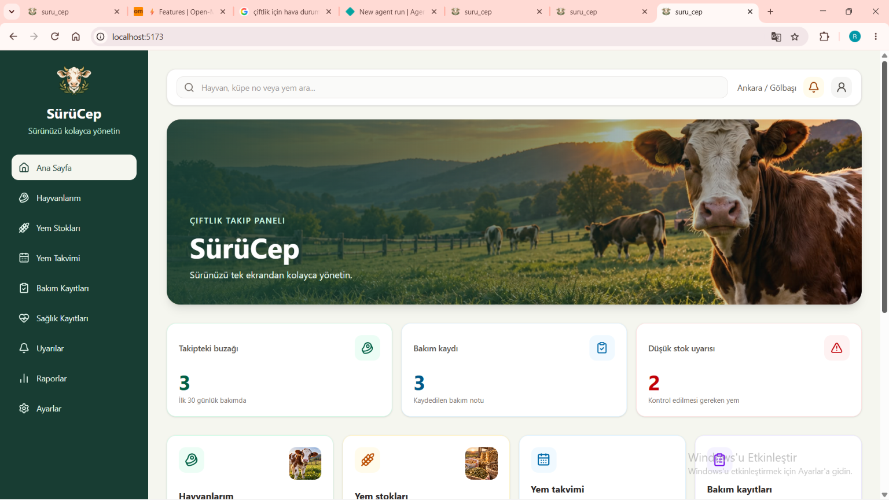
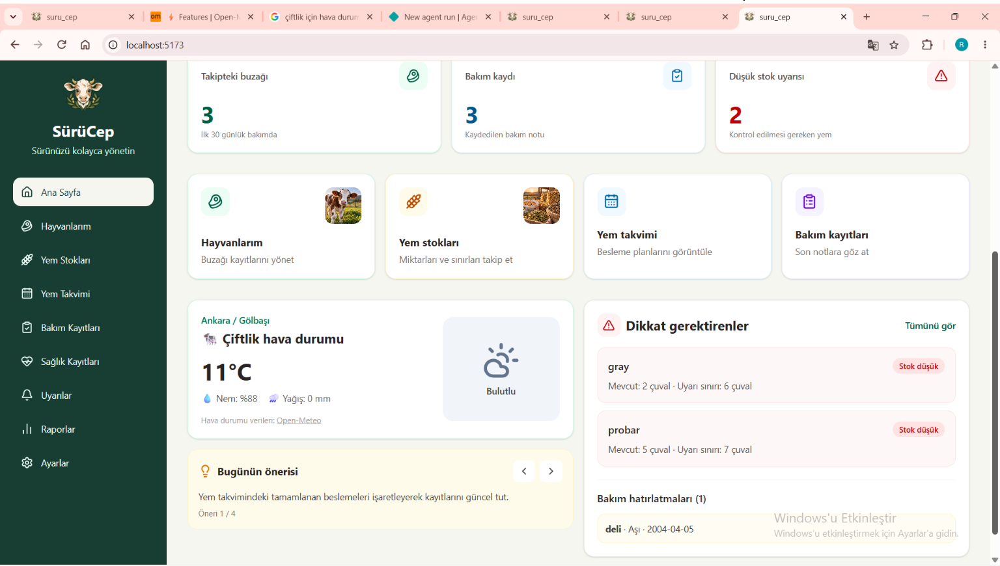
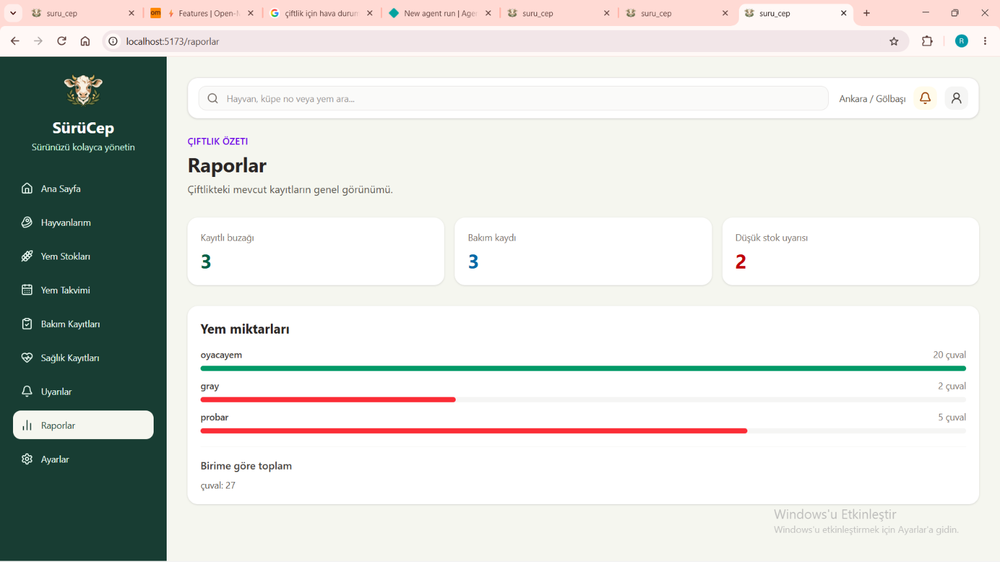
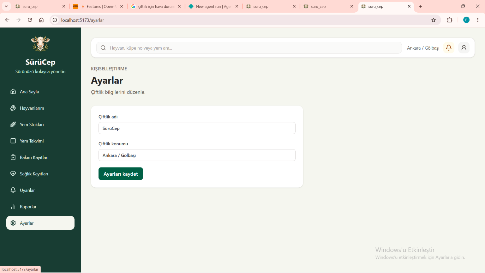
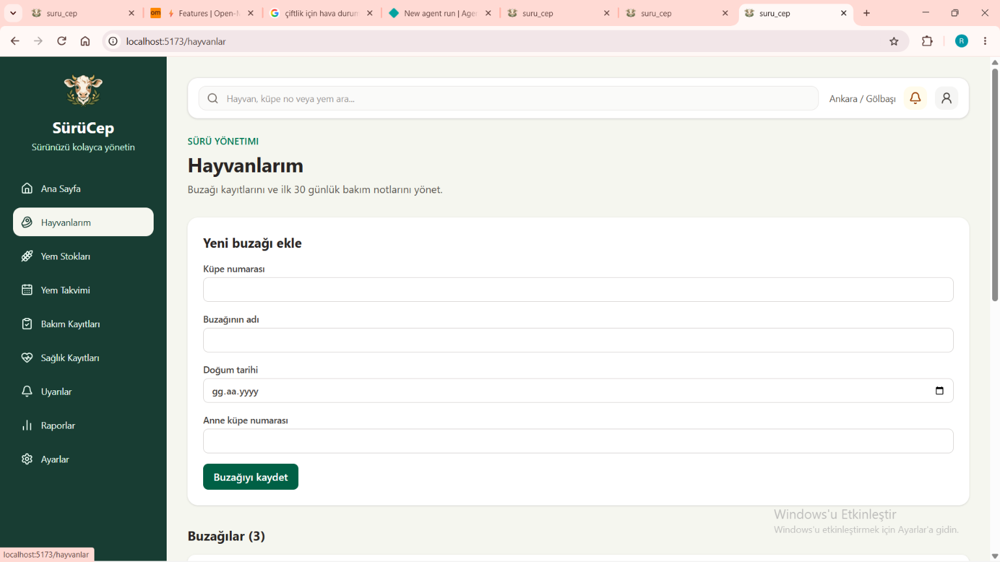
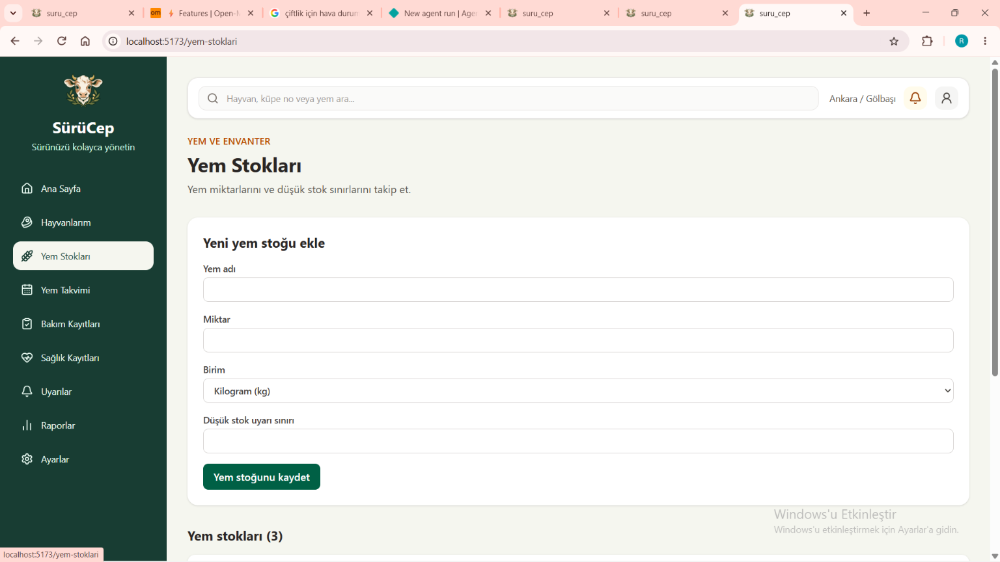
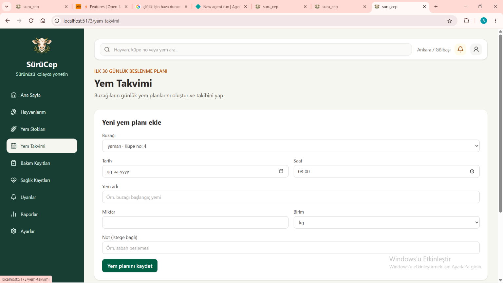

# SürüCeP

SürüCep’i büyükbaş hayvan yetiştiriciliğinde buzağı bakımını ve çiftlikteki yem stoklarını takip etmeyi kolaylaştırmak için geliştirdim. Buzağı kayıtlarını, ilk 30 günlük bakım sürecini, yem stoklarını ve besleme planlarını tek bir web uygulamasında bir araya getirdim.

## Proje Hakkında

Bu projeyi, eğitimde öğrendiğim JavaScript ve React konularını uygulamak ve gerçek bir ihtiyaca yönelik bir web projesi geliştirmek amacıyla hazırladım. Verileri tarayıcıda saklamak için LocalStorage kullandım. Hava durumu bilgilerini Open-Meteo API’sinden alıyorum.

## Özellikler

- Buzağı ekleme, listeleme, düzenleme ve silme
- Buzağıların doğum ve anne küpe numaralarını kaydetme
- Buzağılar için bakım kayıtları ve tarihli hatırlatmalar oluşturma
- Yem stoklarını ekleme, listeleme, düzenleme ve silme
- Düşük stok sınırına göre uyarıları görüntüleme
- Buzağılar için yem takvimi ve besleme planı oluşturma
- Hava durumunu API üzerinden görüntüleme
- Ana sayfada özet kartları, uyarılar ve hızlı erişim bağlantıları
- Kayıtları LocalStorage’da saklama
- Farklı ekran boyutlarına uyumlu web arayüzü

## Kullandığım Teknolojiler

- React
- JavaScript
- Vite
- Tailwind CSS
- React Router
- Lucide React
- LocalStorage
- Open-Meteo API

## Proje Klasörleri

```text
src/
├── Components/
├── Interfaces/
├── Pages/
├── App.jsx
├── App.css
├── index.css
└── main.jsx

public/
└── images/

```

 **COMPONENETS**
 Uygulamada tekrar kullanılan form, menü ve hava durumu bileşenleri
** INTERFACES **
 Buzağı ve yem stoğu verileriyle ilgili dosyalar
** PAGES **
 Ana sayfa ve uygulamanın diğer sayfaları
** PUBLIC/IMAGES ** 
Uygulamada kullandığım görseller
Projeyi Bilgisayarımda Çalıştırma
Önce proje klasöründe terminal açıp bağımlılıkları yüklerim:
npm.cmd install

Geliştirme sunucusunu başlatmak için:
npm.cmd run dev

Projeyi yayına hazırlamak için:
npm.cmd run build

** API **
Hava durumu bilgileri Open-Meteo API’sinden alınmaktadır.

** CANLI PROJE **

Projeyi Netlify üzerinden yayınladım. Uygulamaya aşağıdaki bağlantıdan ulaşabilirsiniz:

[ SürüCep’i görüntüle ](https://surucep.netlify.app)

















## Ekran Görüntüleri

### Ana Ekran


### Uygulama Görünümleri


